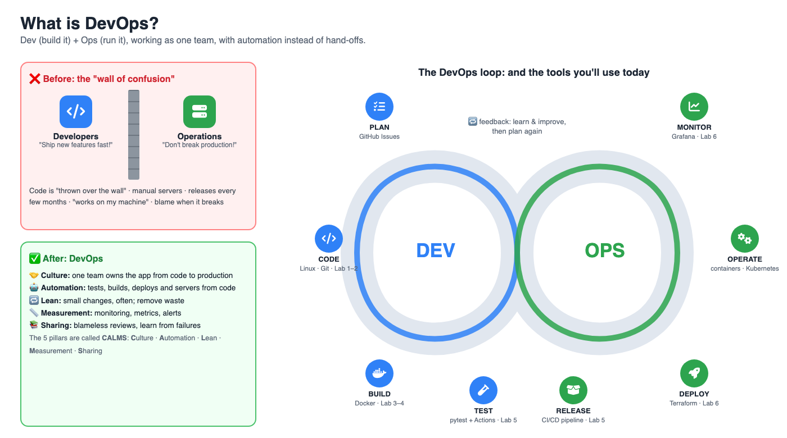
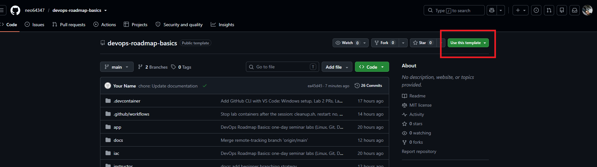

# Lab 0: Setup & What is DevOps? (45 min)

## 🎯 Goals
- Understand what **DevOps** means, why it exists and what it is *not*
- Open your own Codespace, the computer you'll use all day

## 💡 What is DevOps?



### What the word means
**DevOps = Dev + Ops**
- **Dev (Development):** the people who **build** the software: write code, add features, fix bugs.
- **Ops (Operations):** the people who **run** the software: servers, networks, keeping it online, safe and fast.

> **DevOps is a way of working where developers and operations work as one team, and automate the steps from "I wrote some code" to "users are happily using it", so software is delivered quickly *and* safely.**

### Why it was needed: the "wall of confusion"
In the old way, Dev and Ops were separate teams with **opposite goals**:

| Developers wanted… | Operations wanted… |
|---|---|
| To ship new features **fast** | **Stability**: "every change can break production" |

Developers finished the code and **threw it over the wall**. Ops installed it by hand, often weeks later. It broke ("but it works on my machine!"), and each team blamed the other. Releases happened every few months and were scary.

The name **DevOps** appeared around **2009** (Patrick Debois organised the first *DevOpsDays* in Belgium) to describe teams that broke down that wall.

### The 5 ideas behind DevOps: CALMS
| Letter | Idea | What it looks like |
|---|---|---|
| **C** | **Culture** | One team shares responsibility from code to production. "You build it, you run it." No blame. |
| **A** | **Automation** | Robots do repetitive work: tests, builds, deployments, creating servers (today: Docker, GitHub Actions, Terraform) |
| **L** | **Lean** | Small changes, released often. Small changes are easier to test and easier to undo. |
| **M** | **Measurement** | Monitor everything and decide with data (today: Prometheus and Grafana) |
| **S** | **Sharing** | Share knowledge, code and lessons learned. After an incident: fix the process, not the person. |

### How you know it's working
Teams often track four simple numbers, known as the **DORA metrics**:

| Metric | Question it answers | Good teams |
|---|---|---|
| Deployment frequency | How often do we release? | Many times a day |
| Lead time for changes | How long from commit to production? | Less than a day |
| Change failure rate | How often does a release cause a problem? | Rarely |
| Time to restore | When it breaks, how fast do we fix it? | Within an hour |

### ⚠️ What DevOps is *not*
- ❌ **Not a single tool.** You can't "install DevOps". Tools help, but culture comes first.
- ❌ **Not just a job title.** A "DevOps engineer" helps teams automate and run software, but the whole team does DevOps.
- ❌ **Not "Ops does Dev's job" (or the reverse).** It's both working together, with shared goals.

### What does a DevOps engineer do?
Builds and looks after the **road** that code travels on: CI/CD pipelines, containers, cloud infrastructure as code, monitoring and alerts, security checks. Typical day: improve a pipeline, automate a manual task, help a team deploy, investigate an alert. **Today you'll do a small version of all of these.**

### The DevOps loop
```
   PLAN → CODE → BUILD → TEST → RELEASE → DEPLOY → OPERATE → MONITOR
     ▲                                                          │
     └────────────────── learn & improve ◄──────────────────────┘
```

> 💬 **Quick discussion (2 min):** Think of an app you use every day (GCash, Facebook, Grab…). It updates almost every week without going down. What has to be **automated** to make that possible?

| Today's topic | Part of the loop | Why it matters |
|---|---|---|
| Linux terminal | Everywhere | Most servers run Linux and are controlled by typing commands |
| Git & GitHub | Code | Save every version of your work and collaborate safely |
| Docker | Build, Release | "It works on my machine" becomes "it works everywhere" |
| CI/CD | Test, Release, Deploy | Robots test and build your code on every change |
| Infrastructure as Code | Deploy, Operate | Create servers from files, not by clicking around |
| Monitoring | Monitor | Know when something breaks before your users tell you |

## 🛠️ Steps

### 1. Create your own copy of the `devops-roadmap-basics` template
1. Sign in to GitHub.
2. Open the instructor's [`devops-roadmap-basics` template repository](https://github.com/neo64347/devops-roadmap-basics) and click the green **Use this template** button → **Create a new repository**.

   

3. **Repository name:** `devops-roadmap-basics`. Keep it **Public**. Click **Create repository**.
4. Wait for GitHub to create it. Confirm the new repository shows the project files and folders (for example, `app`, `labs`, and `compose.yaml`) before opening a Codespace.

> This creates a separate copy under your GitHub account. You'll push changes and run pipelines in your copy, while the instructor's template stays unchanged.
>
> **Important:** Do not open a Codespace from the instructor's template repository. You can view it, but you don't have permission to push changes there. Open the Codespace from the new repository under your own GitHub account.
>
> If GitHub shows a **Quick setup** page with commands to create or push an existing repository, that repository is empty and was not created from the template. Go back to the instructor's template and use **Use this template**. If the empty repository already uses the name `devops-roadmap-basics`, choose another name for the template copy or delete the empty repository first.

### 2. Open a Codespace
1. In **your** new repo, click **Code** → **Codespaces** tab → **Create codespace on main**.
2. A VS Code editor opens in your browser. The first start takes **1–2 minutes** while it installs tools.
3. When you see a terminal at the bottom with a prompt like `@yourname ➜ /workspaces/devops-roadmap-basics (main) $`, you're ready.

> No terminal? Press <kbd>Ctrl</kbd> + <kbd>`</kbd> (the key above Tab), or use the menu **☰ → Terminal → New Terminal**.

### 3. Check your tools
Copy each command, paste it into the terminal (<kbd>Ctrl</kbd>+<kbd>Shift</kbd>+<kbd>V</kbd> or right-click → Paste) and press <kbd>Enter</kbd>:

```bash
git --version
docker --version
python --version
terraform --version
```

✅ **Checkpoint:** each command prints a version number, for example `Docker version 2x.x.x`.

> **Python test prerequisite:** Python is ready to use, but the app's test tools (including `pytest`) are project dependencies and are not preinstalled in every environment. Install them in a virtual environment from the `app` folder (this also avoids Debian/Ubuntu's externally-managed Python restriction):
> ```bash
> cd app
> python3 -m venv .venv
> source .venv/bin/activate
> python -m pip install -r requirements.txt -r requirements-dev.txt
> ```
> Keep this terminal open for Lab 5, or activate the environment again in a new terminal with `source app/.venv/bin/activate` from the repository root.

## 🆘 Troubleshooting

| Problem | Fix |
|---|---|
| No **Use this template** button | Make sure you're signed in to GitHub |
| Codespaces says **You don't have push permissions** | You opened a Codespace from the instructor's template. Create your own repository with **Use this template**, then open a Codespace from that new repository |
| Codespace stuck on "Setting up" for 5+ minutes | Refresh the page. Still stuck? Go to <https://github.com/codespaces>, delete it, and create a new one |
| `docker: command not found` | Wait a minute (it may still be installing), then open a new terminal |
| Codespaces not available for your account | Ask the instructor for the backup: a free [iximiuz Labs Docker playground](https://labs.iximiuz.com/playgrounds/docker) in the browser ([steps](../instructor/INSTRUCTOR_GUIDE.md#-backup-plan-iximiuz-labs-docker-playground)) |

## 💰 Is Codespaces free?
Personal GitHub accounts get a **free monthly allowance** of Codespaces hours, far more than one day needs. To save hours, **stop** your Codespace when you finish: <https://github.com/codespaces> → **⋯** → **Stop codespace**. It also stops by itself after 30 minutes of inactivity (change this under <https://github.com/settings/codespaces> → **Default idle timeout**). When a Codespace stops, every Docker container inside it stops too, and the lab containers are set **not to restart** by themselves. At the end of the day, [Lab 7](07-wrap-up.md#-before-you-leave) shows how to clean everything up with `bash scripts/cleanup.sh`.

➡️ Next: [Lab 1: Linux terminal basics](01-linux-basics.md)
