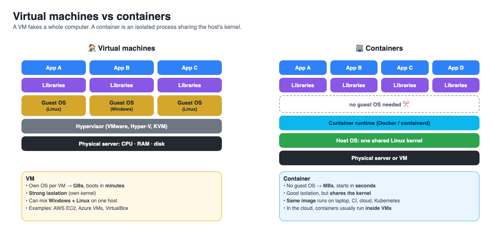
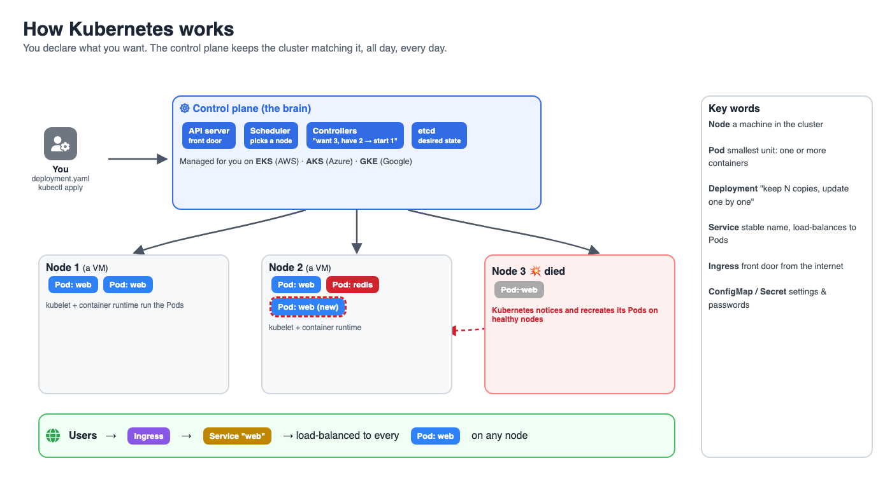
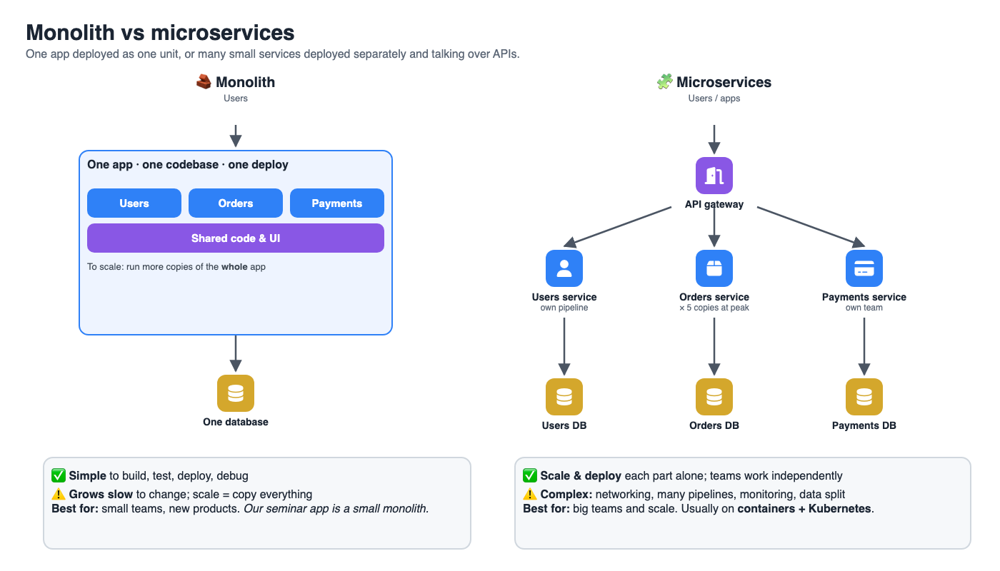
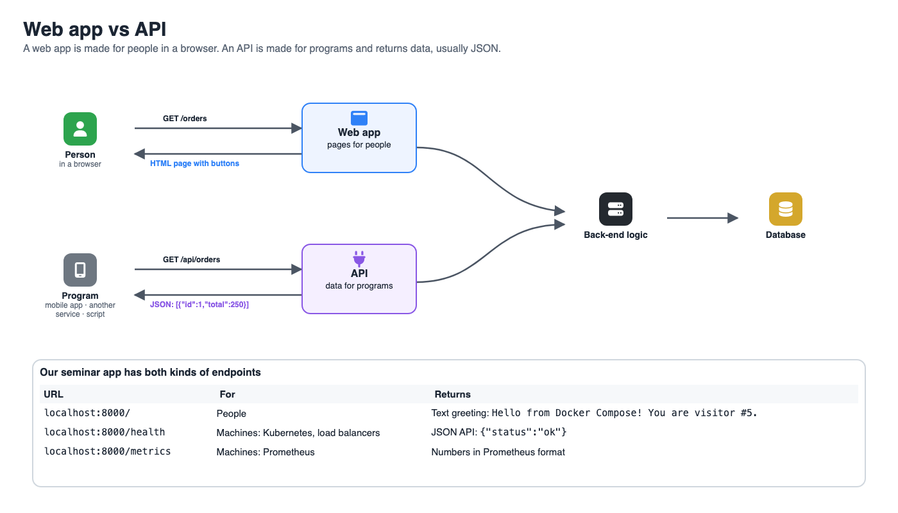
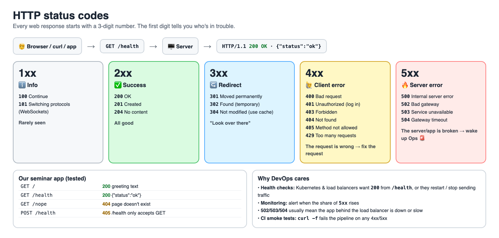
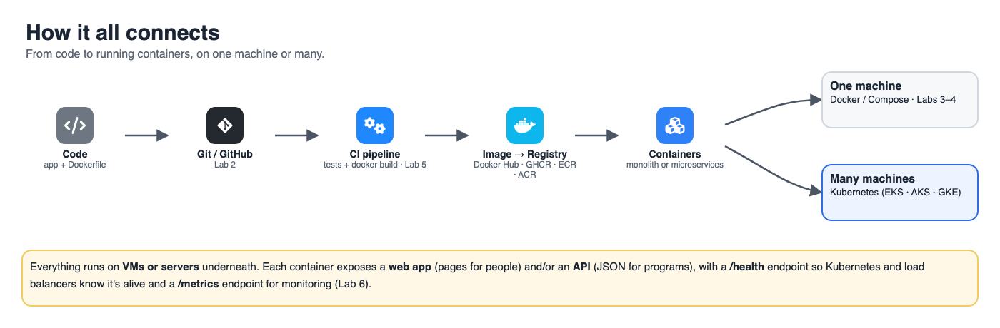

# 💬 Discussion: Containers, Kubernetes & app architecture (30 min)

> **Discussion only, no hands-on.** Nothing to type today. Kubernetes is a big topic that takes weeks to learn properly, so this session gives you the **map**: what it is, why it exists, and the words you'll hear at work. You'll practise it later (see [What to learn next](#-what-to-learn-next)).

## 🎯 Goals
- Explain the difference between a **container**, **Docker** and **Kubernetes**
- Know what problem Kubernetes solves and when you **don't** need it
- Compare **monolith** vs **microservices**
- Tell the difference between a **web app** and an **API**

---

## Part 1: Containers, Docker & Kubernetes (15 min)

### 1. Container vs virtual machine


A **virtual machine (VM)** pretends to be a whole computer: a **hypervisor** splits one physical server into several fake computers, and each runs its **own full operating system**. A **container** doesn't fake a computer. It's a normal process on the host, fenced off so it **thinks** it's alone, and it **shares the host's Linux kernel**.

| | Virtual machine | Container |
|---|---|---|
| What it virtualises | The **hardware** (CPU, RAM, disk) | The **operating system** (processes, files, network) |
| Contains | A whole guest OS + the app | Just the app + its libraries |
| Kernel | Its own | Shared with the host |
| Size | Gigabytes | Megabytes |
| Starts in | Minutes (boots an OS) | Seconds or less (starts a process) |
| How many per server | Tens | Hundreds |
| Isolation & security | Strong: a bug in one VM rarely reaches another | Good, but weaker: all containers share one kernel |
| Different OS? | Yes: Windows and Linux VMs on the same host | Linux containers need a Linux kernel (on Windows/Mac, Docker runs a small Linux VM for you, e.g. WSL2, Colima) |
| Portability | Large VM images, tied to the hypervisor | Same image runs on a laptop, CI, cloud and Kubernetes |
| Made from | A VM image / template (e.g. an AWS AMI) | A container image, built from a `Dockerfile` |
| Typical tools | VMware, Hyper-V, VirtualBox, KVM, AWS EC2, Azure VMs | Docker, containerd, Podman, Kubernetes |
| Updated by | Patching the OS inside (often by hand) | Building a new image and replacing the container |
| Analogy 🏠 | A **detached house**: own foundation, plumbing, roof | An **apartment**: own rooms, shared building and pipes |

**When to use which?**
- **VM:** you need a different OS (e.g. Windows), strong isolation between customers, or old software that expects a full machine.
- **Container:** packaging and shipping your own apps fast and identically everywhere, running many small services, CI/CD.

> 💡 **It's not either/or. Usually it's both.** In the cloud, containers run **inside** VMs: an AWS EC2 or Azure VM is the "server", and Docker or Kubernetes runs containers on it. Your **Codespace today is a VM**, and the web app and Redis ran as **containers inside it**.

### 2. Who's who
| Word | What it is | You used it in |
|---|---|---|
| **Container** | A running, isolated process made from an image | Lab 3 |
| **Image** | The read-only template (recipe 🎂) a container starts from | Lab 3 (`docker build`) |
| **Dockerfile** | The text file that describes how to build an image | Lab 3 |
| **Docker** | The tool that builds images and runs containers on **one machine** | Labs 3–4 |
| **Registry** | Where images are stored and shared: Docker Hub, GitHub Container Registry, AWS ECR, Azure ACR | `docker pull redis` |
| **Docker Compose** | Runs **several containers together** on one machine from one YAML file | Lab 4 |
| **OCI** | The open standard for images and runtimes. Images built with Docker also run on containerd, Podman and Kubernetes | |
| **Kubernetes (K8s)** | Runs containers across **many machines** and keeps them healthy automatically | Today: discussion |

### 3. Why Kubernetes exists
Compose is great on **one** machine. Now imagine a real company:

- 🧑‍🤝‍🧑 **Millions of users:** you need 50 copies of the web app, not 1.
- 💥 **A server dies at 3 a.m.:** who restarts the containers somewhere else?
- 🚀 **A new version:** how do you update without downtime, and roll back if it breaks?
- 📈 **Traffic doubles at lunch:** who adds more copies, then removes them later?

**Kubernetes is the robot that does all of this.** You tell it *what you want* ("3 copies of my web app, always"), and it keeps making reality match. If a container or a whole server dies, it starts a replacement. This is called **desired state**, or being **declarative**: the same idea as Terraform in Lab 6.



### 4. The 6 Kubernetes words you'll hear most
| Kubernetes object | In plain words | Compare with today |
|---|---|---|
| **Node** | A machine (VM or server) in the cluster | Your Codespace |
| **Pod** | The smallest unit: one (or a few) containers running together | One `docker run` |
| **Deployment** | "Keep N copies of this Pod running; update them one by one" | `services: web:` in Compose, but with copies and self-healing |
| **Service** | A stable name/address that load-balances across the Pods | `REDIS_HOST: redis` (Compose's service name) |
| **Ingress** | The front door: routes web traffic from the internet to Services | Port `8000:8000` |
| **ConfigMap / Secret** | Settings and passwords given to Pods | `environment:` in Compose |

Here is **our web app** from Lab 4 as Kubernetes YAML. **Just read it**, don't run it. Notice how close it is to `compose.yaml`:

```yaml
apiVersion: apps/v1
kind: Deployment
metadata:
  name: web
spec:
  replicas: 3                     # ← Compose runs 1; Kubernetes keeps 3 alive
  selector:
    matchLabels: { app: web }
  template:
    metadata:
      labels: { app: web }
    spec:
      containers:
        - name: web
          image: ghcr.io/YOUR-USERNAME/devops-demo:v1   # image from a registry
          ports: [{ containerPort: 8000 }]
          env: [{ name: REDIS_HOST, value: redis }]
          livenessProbe:          # ← K8s calls /health and restarts the Pod if it fails
            httpGet: { path: /health, port: 8000 }
---
apiVersion: v1
kind: Service
metadata:
  name: web
spec:
  selector: { app: web }
  ports: [{ port: 80, targetPort: 8000 }]
```

Remember the `/health` endpoint from Lab 3? This is exactly why apps have one: Kubernetes uses it to decide whether a container is healthy.

### 5. Where Kubernetes runs
- **Managed (most companies):** Amazon **EKS**, Azure **AKS**, Google **GKE**. The cloud runs the control plane for you.
- **On your laptop, for learning:** **kind**, **minikube**, **k3d**, or the Kubernetes option in Rancher Desktop.
- **Tools you'll meet:** `kubectl` (the CLI), **Helm** (packages of YAML), **Argo CD** (GitOps: deploys from Git), **k9s** (a terminal UI).

### 6. ⚠️ When you DON'T need Kubernetes
Kubernetes is powerful but **complex** and has a running cost. Small apps are often better on:
- **Docker Compose** on one server
- **Serverless containers:** AWS ECS Fargate / App Runner, Azure Container Apps, Google Cloud Run (you give them an image; they run it)
- **PaaS:** Heroku, Render, Azure App Service

> 💡 Rule of thumb: start simple. Move to Kubernetes when you have **many services, many teams, or serious scale**. Not because it's popular.

### 💬 Discuss (pairs, 3 min)
1. Your Lab 4 Redis container crashes. What happens with **Compose**? What would happen with **Kubernetes**?
2. A local bakery's website gets 100 visitors a day. Kubernetes or not? Why?
3. Which Kubernetes object is most like the `services:` section in `compose.yaml`?

<details><summary>Possible answers</summary>

1. Compose: it stays down unless you set `restart:` or start it yourself. Kubernetes: the Deployment notices and starts a new Pod automatically.
2. Not. A single small server, PaaS or serverless container is cheaper and simpler.
3. A **Deployment** (what to run, how many) plus a **Service** (how to reach it by name).
</details>

---

## Part 2: Monolith vs microservices, web app vs API (15 min)

### 1. Monolith vs microservices


| | Monolith | Microservices |
|---|---|---|
| What | One codebase, deployed as **one unit** | Many small services, each **deployed separately** |
| Analogy 🍽️ | One restaurant kitchen where every cook does everything | A food court: each stall does one thing and they work together |
| Great for | Small teams, new products, simple apps | Large teams, big scale, parts that change at different speeds |
| Easy | Develop, test, debug, deploy (one thing) | Scale one busy part; teams work independently; one crash ≠ everything down |
| Hard | Big codebase gets slow to change; scale = copy everything | Networking, monitoring, many pipelines, data spread across DBs |
| Needs | One server or container | Containers, CI/CD per service, often **Kubernetes**, good **monitoring** |

> **Our seminar app is a small monolith** (one Flask app) that uses a separate Redis database. In a microservices world, the visit counter might become its own "counter service" with its own API.

> 💡 Many successful companies **start as a monolith** and split out services only when a part really needs it. Microservices are a trade-off, not an upgrade.

### 2. Web app vs API
| | Web app | API |
|---|---|---|
| Made for | **People**, using a browser | **Programs** talking to other programs |
| Returns | HTML pages, CSS, images, buttons | Data, usually **JSON** |
| Example | gmail.com in your browser | The Gmail app on your phone fetching your emails as JSON |
| Analogy 🍔 | The restaurant's dining room and menu | The kitchen's order window: a fixed way to ask and receive |

A modern product is often **both**: a web front end (React, Angular…) in the browser calls the back end's **API** to get data.



**Our app has both kinds of endpoints.** Your instructor can show this on the projector:

| URL | Who it's for | What you get |
|---|---|---|
| `localhost:8000/` | People | A text greeting: `Hello from Docker Compose! You are visitor #5.` |
| `localhost:8000/health` | Machines (Kubernetes, load balancers) | JSON API: `{"status":"ok"}` |
| `localhost:8000/metrics` | Machines (Prometheus) | Numbers in Prometheus format |

### 3. API words in 60 seconds
| Word | Meaning |
|---|---|
| **REST API** | The most common style: URLs for things (`/orders/42`) + HTTP methods |
| **HTTP methods** | `GET` read · `POST` create · `PUT`/`PATCH` update · `DELETE` remove |
| **Status codes** | A 3-digit number on every response: `200` OK, `404` Not found, `500` Server error… [See below](#4-http-status-codes) |
| **JSON** | The text format most APIs use: `{"status": "ok"}` |
| **Endpoint** | One URL of an API, e.g. `/health` |
| **API gateway** | The front door for many microservices (auth, rate limits, routing) |

### 4. HTTP status codes
Every web response, to a browser or to a program, starts with a **3-digit status code**. The **first digit** tells you what happened and **whose fault** it is.



| Family | Meaning | Common codes | Think of it as… |
|---|---|---|---|
| **1xx** | Information | `100` Continue, `101` Switching protocols | "Hold on…" (rarely seen) |
| **2xx** ✅ | Success | `200` OK · `201` Created · `204` No content | "Here you go!" |
| **3xx** ↪️ | Redirect | `301` Moved permanently · `302` Found (temporary) · `304` Not modified | "It's over there" |
| **4xx** 🙋 | **Client** error: the request is wrong | `400` Bad request · `401` Unauthorized (log in) · `403` Forbidden · `404` Not found · `405` Method not allowed · `429` Too many requests | "**You** asked wrong": fix the request |
| **5xx** 🔥 | **Server** error: the app or server failed | `500` Internal server error · `502` Bad gateway · `503` Service unavailable · `504` Gateway timeout | "**We** broke": Ops gets paged 🚨 |

> 🍔 **Restaurant analogy:** `200` your food arrives · `301` "we moved to a new address" · `404` "that's not on the menu" · `401` "members only, show your card" · `429` "one order at a time, please" · `500` "the kitchen is on fire" · `503` "we're closed for cleaning".

**Our seminar app returns real status codes** (tested):

| Request | Status | Why |
|---|---|---|
| `GET /` | `200 OK` | Greeting text |
| `GET /health` | `200 OK` | `{"status":"ok"}` |
| `GET /nope` | `404 Not Found` | That page doesn't exist |
| `POST /health` | `405 Method Not Allowed` | `/health` only accepts `GET` |

**👀 Instructor demo (optional, 1 min):** show the status line on the projector:
```bash
curl -i localhost:8000/health                                   # first line: HTTP/1.1 200 OK
curl -s -o /dev/null -w '%{http_code}\n' localhost:8000/nope    # 404
curl -s -o /dev/null -w '%{http_code}\n' -X POST localhost:8000/health   # 405
```

**Why DevOps engineers care about status codes**
- **Health checks:** Kubernetes and load balancers call `/health` and expect `200`. Anything else → restart the container or stop sending it traffic.
- **CI/CD smoke tests:** `curl -f` exits with an error on a 4xx/5xx, so the pipeline fails. That's exactly how our [Lab 5 pipeline](05-ci-cd-github-actions.md) checks `/health`.
- **Monitoring & alerts:** a few `404`s are normal; a rise in **`5xx`** means users are hitting errors → alert.
- **`502` / `503` / `504`** usually come from the **load balancer or gateway in front of your app**: the app behind it is down (`502`/`503`) or too slow (`504`). Look at the app, not the load balancer.

### 💬 Discuss (pairs, 4 min)
1. A start-up with 3 developers is building its first product. Monolith or microservices?
2. Is `localhost:8000/health` part of a web app or an API? How can you tell?
3. Why does each microservice usually need its own CI/CD pipeline and monitoring?
4. Your monitoring shows many `503` errors, but no `404`s. Is the problem in the users' requests or in your app? What do you check first?

<details><summary>Possible answers</summary>

1. Usually a monolith: faster to build and change. Split later if needed.
2. An API: it returns JSON for programs, not a page for people.
3. Each one is built and deployed separately, and with many services you need monitoring to see which one is failing.
4. In your app or servers: `5xx` means the server side failed (`503` = service unavailable). Check whether the app's containers are running and healthy (`docker compose ps`, logs, `/health`).
</details>

---

## 🔗 How it all connects


## 📚 What to learn next
Kubernetes is **stage 8** of the [DevOps roadmap](../docs/roadmap.md). Free ways to start:
- [Kubernetes Basics tutorial](https://kubernetes.io/docs/tutorials/kubernetes-basics/) (official, interactive)
- [iximiuz Labs](https://labs.iximiuz.com) and [Killercoda](https://killercoda.com) for browser-based Kubernetes playgrounds
- Locally: install **kind** or **minikube**, then deploy today's app with the YAML above
- Microservices: [microservices.io](https://microservices.io/patterns/) (patterns explained)

➡️ Next: [Lab 5: CI/CD with GitHub Actions](05-ci-cd-github-actions.md)
