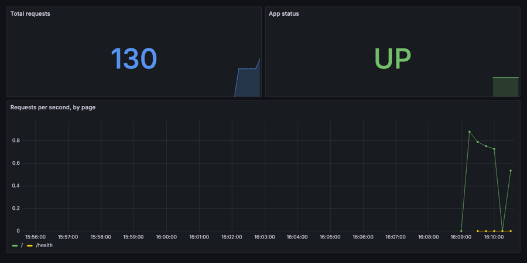

# Lab 6: Cloud, Infrastructure as Code & Monitoring (60 min)

## 🎯 Goals
- Know what "the cloud" is and its 3 service models
- Use **Terraform** to create and destroy something from code
- See your app on a live **Grafana** dashboard, and catch it going down

No cloud account or credit card needed.

---

## Part A: The cloud in 5 minutes ☁️
**The cloud = renting someone else's computers over the internet**, paying only for what you use (AWS, Microsoft Azure, Google Cloud).

| Model | You manage | Example | Pizza analogy 🍕 |
|---|---|---|---|
| **IaaS** | Servers, OS, app | AWS EC2, Azure VM | Buy ingredients, bake at home |
| **PaaS** | Just your app | Heroku, Azure App Service | Pizza delivered, you set the table |
| **SaaS** | Nothing, just use it | Gmail, GitHub | Eat at the restaurant |

Your Codespace? It's a cloud VM running your container. You've been using the cloud all day.

---

## Part B: Infrastructure as Code with Terraform 🏗️

### 💡 The idea
Clicking around a cloud console to create 50 servers is slow and error-prone, and nobody remembers what was clicked. With **IaC** you **describe** infrastructure in files, keep them in **Git**, and a tool creates it **exactly the same every time**.

```
 main.tf ──terraform plan──► "here's what I WILL do" ──terraform apply──► done ✅ ──terraform destroy──► gone 🧹
```

### 🛠️ Steps
```bash
cd iac
cat main.tf
```
It describes one resource: a file. (In real life this would be a server, a database or a network. The workflow is identical.)

```bash
terraform init                                   # download the plugin ("provider")
terraform plan -var="student_name=YOUR NAME"     # preview: nothing changes yet
terraform apply -var="student_name=YOUR NAME"    # type: yes
cat output/welcome.txt
```
✅ `Hello YOUR NAME! This file was created by Terraform.`

Now run `apply` **again** with the same name. Terraform says **No changes**, because the real world already matches the code. Change the name and apply again: it updates only what's different.

Clean up:
```bash
terraform destroy      # type: yes
cd ..
```

> 🏋️ **Optional stretch:** `iac/docker-stretch/main.tf` uses Terraform to start a real nginx container. Run `terraform init` and `terraform apply` inside that folder, open port **8080**, then `terraform destroy`.

---

## Part C: Monitoring with Prometheus & Grafana 📈

### 💡 The idea
Once your app is live, how do you know it's healthy? **Monitoring**:
- **Prometheus** collects numbers (metrics) from your app every few seconds.
- **Grafana** turns them into dashboards and alerts.

```
 web app /metrics ◄──scrape every 5s── Prometheus ◄──query── Grafana dashboard 📊
```

### 🛠️ Steps
Our app already exposes metrics:
```bash
docker compose --profile monitoring up -d --build
curl localhost:8000/metrics | grep app_requests_total
```

Make some traffic (sends 50 requests):
```bash
for i in $(seq 1 50); do curl -s localhost:8000 > /dev/null; done
```

Open **Grafana**: **PORTS** tab → port **3000** → 🌐 (own PC: <http://localhost:3000>). Go to **☰ Dashboards → Seminar → Web App**.

> 🔌 **Shortcut:** `bash scripts/start.sh` starts all of this and prints the links for ports **8000**, **3000** and **9090** with a ✅ for each. Missing a port? See [Run the app and open the 3 ports](../docs/ports.md).



Keep the dashboard open and generate more traffic. Watch the graph rise (it refreshes every 5 seconds).

### 🔥 Simulate an outage
```bash
docker compose stop web
```
Within about 10 seconds, **App status** turns **DOWN** 🔴. In real teams this would trigger an **alert** to the on-call engineer's phone. Bring it back:
```bash
docker compose start web
```
✅ Back to **UP** 🟢.

Curious? Open **Prometheus** on port **9090** and try the query `app_requests_total`.

Clean up:
```bash
docker compose --profile monitoring down
```

## ✅ Checkpoint
- [ ] You can name the 3 cloud service models
- [ ] You ran `plan`, `apply` and `destroy`, and saw "No changes" on a repeat apply
- [ ] You saw the dashboard react to traffic and to an outage

## 🆘 Troubleshooting
| Problem | Fix |
|---|---|
| Grafana shows "No data" | Wait 10–20 seconds and generate traffic. Check the time range (top right) is "Last 15 minutes" |
| Port 3000 not listed | Run `docker compose --profile monitoring ps`. All 4 services should be running |
| `terraform: command not found` | Rebuild the Codespace, or ask the instructor |
| Terraform `Error acquiring the state lock` | Another terraform command is running. Wait, or press <kbd>Ctrl</kbd>+<kbd>C</kbd> and retry |

➡️ Next: [Lab 7: Wrap-up & your roadmap](07-wrap-up.md)
